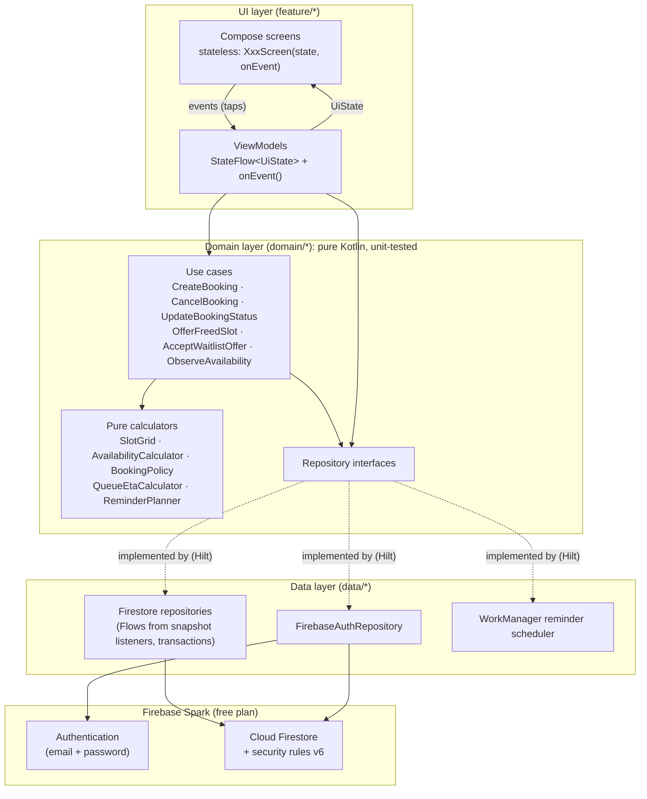
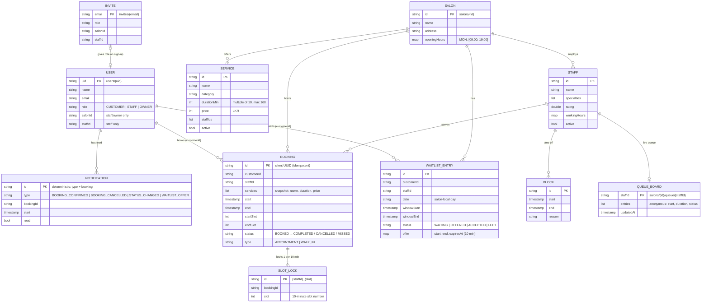
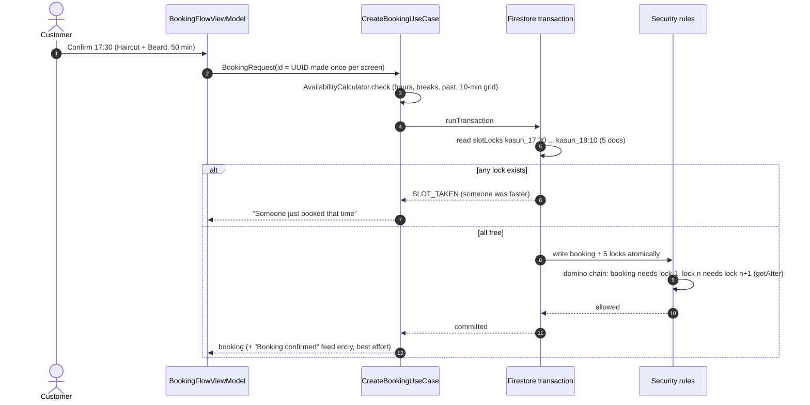
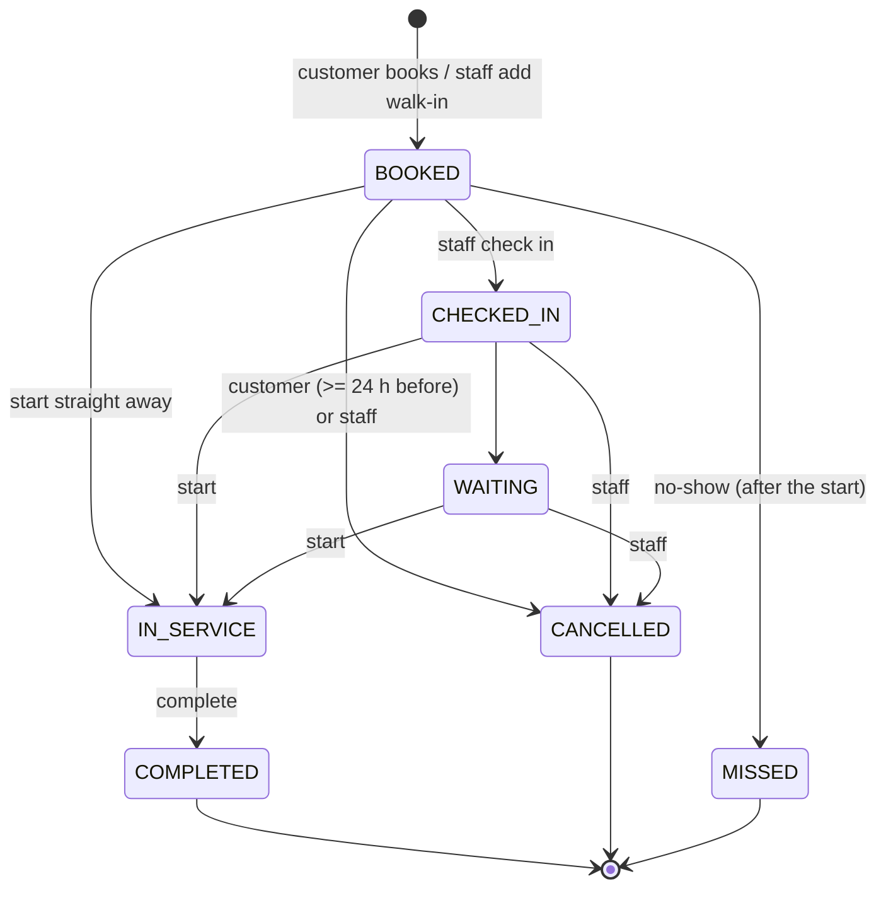

# SalonLink — Architecture

EC5208 Mobile Application Development · Group 12

The diagrams are Mermaid. GitHub and Android Studio (Markdown preview) draw them directly.

## 1. Layers

SalonLink follows Google's *Guide to App Architecture*: **UI → domain → data**, with MVVM and
unidirectional data flow. Each screen is a stateless `XxxScreen(state, onEvent)` with a
`@Preview`, plus a ViewModel that exposes one `UiState` and one `onEvent()` function.

| Package | What lives there |
|---|---|
| `core/designsystem` | Theme (Figma tokens), gradient buttons, cards, `SalonPhoto`, `FormBanner` |
| `core/navigation` | Type-safe `@Serializable` routes, role shells (customer / staff / owner) |
| `core/notifications` | `SystemNotifier`: notification channels for reminders and salon updates |
| `domain/model` | `Booking`, `BookingStatus` (with its transition table), `Salon`, `Staff`, `WaitlistEntry`… |
| `domain/booking` | `SlotGrid`, `AvailabilityCalculator`, `BookingPolicy` (60-day window, 24 h cancel rule) |
| `domain/usecase` | Booking engine and waitlist use cases |
| `data/firestore` | Mappers, `FirestoreSchema` (field names), Flow helpers, `awaitWrite()` |
| `data/repository` | Firestore and Firebase Auth implementations |
| `feature/*` | One folder per screen: `XxxScreen.kt` + `XxxViewModel.kt` |

**Why no Cloud Functions:** they need the paid Blaze plan. Everything a server would usually
guarantee is done with **Firestore transactions and security rules** instead (see §3).

## 2. Firestore data model (ER diagram)

Privacy: customers never read other people's bookings (T09). They see availability through the
**anonymous** `slotLocks` and the live queue through the **anonymous** queue boards, which hold
no names.

## 3. Booking engine: no double booking without a server

- **T03, two phones at once:** Firestore runs the transactions one after the other. The second
  one sees the locks and fails, so at most one booking can exist.
- **T11, network drop:** the booking id is a UUID created once per Confirm screen. A retry
  rewrites the same document and never makes a second booking.
- **Cancel / no-show:** one transaction marks the booking and deletes its locks. Then
  `OfferFreedSlotUseCase` offers the time to the first matching waitlisted customer (FIFO,
  10 minutes). Accepting goes through the same engine, so two people can't both win it.

## 4. Booking status machine

The table lives in one place (`BookingStatus.canTransitionTo`) and is copied into the rules. Staff
screens show only the buttons the table allows (`Booking.staffActions`), so the UI never offers a
move the rules would refuse.

## 5. Background work and notifications

| What | How | Why this way |
|---|---|---|
| Reminders 24 h and 2 h before | WorkManager (`BookingReminderWorker`, Hilt worker), re-planned on every change to "my bookings" | Works offline and survives restarts. The worker re-reads the booking, so a cancelled one stays silent. |
| Salon updates (checked in, completed, waitlist offer) | Firestore feed `users/{uid}/notifications`, turned into phone notifications while the app runs | Sending FCM push needs a server (Blaze). |
| Live queue | The staff/owner app publishes an anonymous board per barber whenever today's bookings change. Customers compute position and ETA with `QueueEtaCalculator`. | No server to compute it. |
| Offline writes | Transactions fail fast with a NETWORK error. Plain writes wait at most 8 s, then count as queued on the phone (`awaitWrite`). | No spinner stuck forever while offline. |

## 6. Known limitations (Spark plan)

- The waitlist offer is made by the cancelling device, so waitlist entries are readable by any
  signed-in user (they hold a uid, never a name), and an offer is a first chance, not a
  reservation. With Cloud Functions this would move to the server.
- No server push: notifications appear while the app runs, and reminders are local.
- AI concierge (Phase 8) is on hold. The Concierge tab shows a "coming soon" screen.
